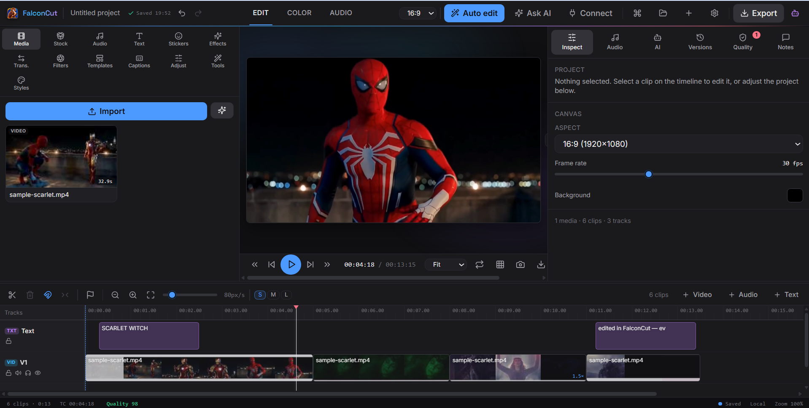
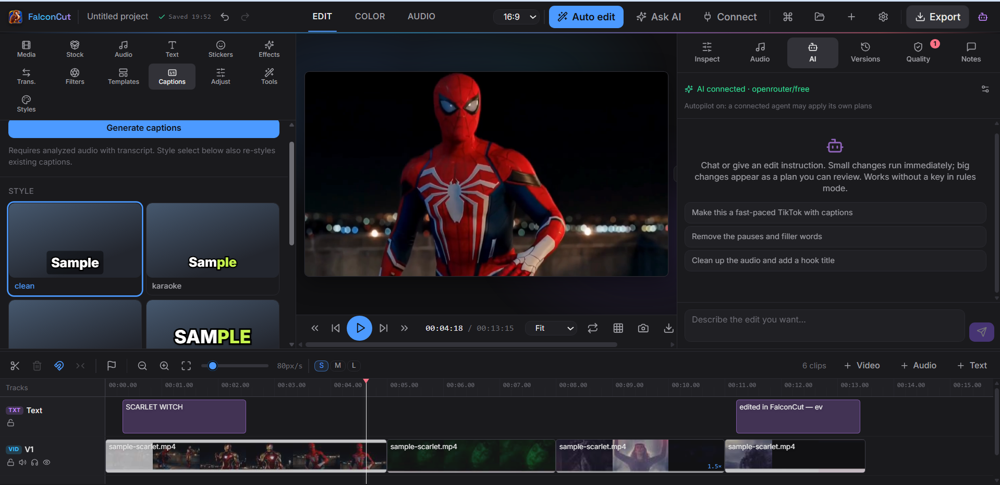
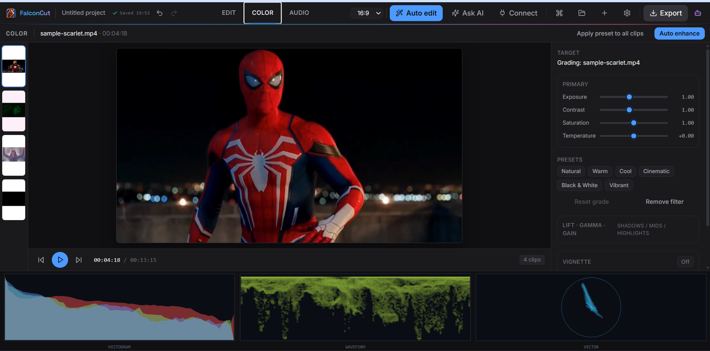

# FalconCut

**Edit with Creativity. Create with AI.**

A modern video editor built for human creators and AI agents. Create, edit, automate, and export videos with a powerful professional editing workflow.

Manual editing is the primary path: every cut, speed ramp, reverse, grade, LUT, title, transition and export is one real button (each = one undo step), preview and export use the exact same engine, and nothing waits on a model. AI is a second pair of hands — connect a key and it can plan edits, cut dead air and write captions; without a key, **every feature still works from buttons via local rules**.

Privacy-first by design: media never leaves the device — no uploads, no account, no backend.

## Screenshots

**Editor — media panel, preview, multi-track timeline and inspector**



**Captions and the optional AI assistant**



**Color workspace with live scopes**



## Why it's fast and premium

- **No upload wait.** Import a long clip and start cutting immediately — decoding, grading, effects and export all run on your machine.
- **WYSIWYG guarantees.** The preview canvas is the export engine, so what you see is exactly what renders.
- **One action, one undo.** Every tool (human click or AI tool call) is a single undoable commit.
- **Keyboard-first, Premiere-style.** V select, C razor, I/O zone, Ctrl+K add-edit-all, Shift+←/→ frame steps, full cheatsheet in the command palette.
- **Vertical-first and platform-ready.** 9:16 / 16:9 / 1:1 / 4:5 with caption-safe zones, one click — and the export dialog has delivery targets (TikTok/Reels/Shorts, YouTube, Instagram feed, square) that reframe the whole project in one undo step, so preview, timeline and file match the platform in a single click.
- **Honest labels.** The in-app capability board (`src/features/checklist.ts`) marks every feature `working`, `partial` or `not-possible` — no fake buttons.

## Quickstart

**Requirements:** Node.js 18+ and a Chromium-based browser (Chrome or Edge) for the best experience (see [Browser requirements](#browser-requirements)).

> **Why double-clicking `dist/index.html` doesn't work:** a web app cannot run from `file://` — ES modules, service workers and IndexedDB all require an `http(s)` origin. That's a browser security rule, not an app bug. FalconCut ships a launcher that gives it a real localhost origin, and from there the browser installs it as a **PWA with a desktop/home-screen icon** that opens standalone and works offline.

**Windows - one double-click:** run **`Start FalconCut.bat`**. First run installs dependencies and builds (about a minute), then opens `http://localhost:4173` in a Chrome/Edge app window (no address bar).

**Windows desktop icon (recommended):** right-click **`Install FalconCut.ps1`** → *Run with PowerShell* (or run `powershell -ExecutionPolicy Bypass -File ".\Install FalconCut.ps1"`). It creates **FalconCut shortcuts on the Desktop and in the Start Menu**, using `public/falconcut.ico` (real artwork, 16–256 px) and launching through a hidden `Start FalconCut.vbs`, so clicking the icon starts the server and opens the editor in its own window - the same behaviour as the other app icons on your desktop. The shortcut is a normal Windows `.lnk`; delete it to uninstall.

Or manually, on any OS:

```bash
npm install        # install dependencies
npm run build      # type-check + production build to dist/
npm run serve      # static server at http://localhost:4173
```

**Install the app icon:** open the URL in Chrome or Edge → click the **install icon** in the address bar (or ⋮ → *Install FalconCut*). Android: ⋮ → *Add to Home screen*. iOS 16.4+ Safari: Share → *Add to Home Screen*. Launching the icon opens FalconCut standalone with no address bar, and the shell loads offline — projects and media live in local IndexedDB.

Dev workflow (hot reload at `http://localhost:5173`):

```bash
npm run dev
```

Tests (108-test suite — timeline, effects, store, tools, chat, assets, exports, region crop):

```bash
npm run test
```

## Features

FalconCut's honest, always-up-to-date status board lives in [`src/features/checklist.ts`](src/features/checklist.ts) — it is rendered in-app and marks every capability as `working`, `partial`, or `not-possible`. Highlights:

- **Built for humans first** — every tool has a real button and a real undo step; the AI panel is optional. The demo timeline shows straight cuts, reverse, speed, titles and captions in one shot.
- **Multi-track timeline** — video + audio tracks, split/trim/ripple delete, drag clips between compatible tracks, drag past the top/bottom edge to auto-create a matching track (one undo step), configurable snapping (magnetic edges/playhead/markers, `N` toggles, `Alt` bypasses), marquee select, copy/cut/paste/duplicate, track solo/reorder/delete, undo/redo, autosave to browser storage.
- **Region crop & extraction** — select a clip, open the crop tool, and drag the exact area to keep (resizable box with corner/edge handles, red selection border). **Apply Crop** crops the clip non-destructively; **Extract as New Clip** leaves the original untouched and adds an independent clip (same source, same timing) on a free video track. Cropping is a render-time source rectangle shared by preview and export — no re-encode, no resolution change, source pixels preserved. The tool is a compact drag-and-two-actions overlay that fits any canvas aspect, including 9:16. Current-frame PNG export and freeze frames are lossless too.
- **Speed ramps & freeze frames** — clip speed 0.25x–4x, piecewise time remapping with a graphical ramp editor (ramp-aware split/trim/ripple keep continuity), one-click freeze frames from the preview transport, and true clip reverse (video scrubs frame-by-frame, audio plays a genuinely reversed buffer — preview and export match).
- **Blend modes & blend transitions** — screen, multiply, overlay, add, soft-light and more via canvas compositing, plus 15 blend-style transitions. The same engine renders preview and export, so what you see is what you get.
- **Drawing & direct manipulation** — 12 draw tools (brush, pen, arrow, shapes, stickers…) as independent editable overlay layers; drag-move, corner-resize, rotate, and inline text edit directly on the preview.
- **Captions & titles** - automatic transcription with Whisper running as WASM in a web worker, density presets, and six animated caption presets (Default, TikTok, Karaoke, Beast, Focus, Mogul) with graphical preview cards. Words reveal on their own speech timing with an active-word highlight (instant/slide/pop/scale/fade/wipe/color/moving-bar), fully editable per-word color, weight, italic and timing, plus highlight colors, padding, radius, opacity, glow and shadow. Presets add real clips burned into preview and export (no sidecar needed); `.srt`/`.vtt` sidecar export and import, translation (needs an AI key). The Text tab adds titles and captions with effect and fade-transition chips.
- **Color grading** — lift/gamma/gain per channel, hue/temperature/saturation, preset looks, auto-normalize, live scopes (waveform, vectorscope, histogram) in the Color workspace, and `.cube` LUT import with per-clip strength.
- **Audio DSP** — compressor, limiter, echo, pan, fades, LUFS loudness normalization, noise reduction/de-ess/high-pass, auto music ducking, in-app voiceover recording.
- **Export** — MP4 (H.264 + AAC) via WebCodecs when available, WebM (VP9/Opus) otherwise, audio-only WAV, current-frame PNG, animated GIF of a marked section, and `.srt` subtitles.
- **Stock media panel** — search and import free stock media (Archive.org works keyless; Pexels/Pixabay/Freesound use a free personal key stored locally).
- **Keyboard shortcuts** — Premiere-style edit keys (V select, C razor, I/O zone, Ctrl+K add-edit-all…) plus a full cheatsheet in the command palette.
- **Optional AI assistant** — the chat behaves like an assistant, not a plan machine: greetings and questions get plain answers, small edits ("add a bold Welcome title", "trim the first 5 seconds") run immediately and are confirmed in one sentence, and only genuinely multi-step work ("edit this whole video like a cinematic trailer") appears as a reviewable plan. It reads the live project — clip ids, tracks, timings, transcript and quality report — before acting, keeps the conversation as context, streams replies, and every applied edit is one undo step ("undo that" works). Failures show the real reason with a Retry button; it never shows raw JSON or invents a success. Model settings support OpenAI, OpenRouter and Google Gemini (native protocol) plus any OpenAI-compatible or local endpoint, with a **Fetch models** button that lists the models your key can actually use and a **Test connection** button that sends one tiny real request with the values in the form.
- **PWA — installable on every device** — install FalconCut as an app on Windows, macOS, Linux, Android (Chrome) and iOS (Safari 16.4+). A service worker caches the app shell, so an installed editor keeps working offline — media lives in IndexedDB on the device either way. The installed icon is the real FalconCut artwork, including 192/512 maskable variants for Android's adaptive shape.

Honest limits worth knowing: no 3D camera space, no optical-flow frame blending, no true motion blur on animated transforms, no Lottie/AE animation import, region extraction is rectangle-only for now (no elliptical/polygon masks, feathering or rotoscoping), no music stem separation, no direct publishing to YouTube/TikTok. The checklist file is the source of truth.

## Optional AI setup

AI is **fully optional** — all core editing works without any key. If you want model-driven planning (auto edit, caption translation, AI chat), open **Settings → AI** and pick a provider:

| Provider | Key from | Preset model |
|---|---|---|
| **OpenAI-compatible** (any vendor) | OpenAI, Groq, Together, Mistral, DeepSeek, Fireworks, Perplexity — one-tap presets in the dialog | `gpt-4o-mini`, or Fetch models for the exact name |
| **Local server** | no key needed — Ollama, LM Studio, vLLM, any gateway | your own model name |
| **OpenRouter** | openrouter.ai/keys — one key, hundreds of models | `auto` (picks whatever your credits allow) |
| **Google Gemini** | aistudio.google.com | `gemini-3.8-flash` |

1. Select the provider, then (for the compatible family) tap the vendor chip — endpoint and model are preset to a pair that works. Or paste any `…/chat/completions` URL.
2. Paste the key (leave it empty for a local server — that's supported).
3. **Verify** (shield button beside the key) sends one tiny request and tells you whether this key is valid for this endpoint — before you save anything.
4. **Test connection** does the same through the full agent path; **Fetch models** lists the models your key can actually use.

**Google key formats:** AI Studio now issues two kinds of API key, and **both are valid** — standard keys starting with `AIza…` and the newer authorization keys starting with `AQ.…`. Paste either one with Provider set to *Google Gemini*; FalconCut sends it the way Google expects (`x-goog-api-key`, then retries with `?key=` if the project requires it). `AQ.…` keys only work on the native Gemini endpoint, not on the OpenAI-compatible `/openai/` path, so the dialog warns if the provider and key type disagree. If a key fails, the error names the real reason (bad key, restricted key, wrong model, quota) instead of guessing from the prefix.

**How the chat behaves:** the assistant decides per message. Conversation → a normal reply, no plan and no tools. A clear small edit → the tool runs immediately and you get a one-sentence confirmation. A large or multi-part request → a short plan generated for that request, which you can Run or Reject. With no key, the built-in rules engine still handles clear instructions and says so honestly; it never pretends to be a language model.

**Why OpenAI used to fail in the browser:** `api.openai.com` refuses browser cross-origin requests, and no client-side code can work around that. When FalconCut runs from its own local server (`Start FalconCut.bat`, `npm run serve` or `npm run dev`) those calls are proxied through the same origin — bound to loopback only, with a header allowlist, and your key still goes straight to the provider. The dialog shows whether the proxy is active.

**Keys are stored in your browser's `localStorage` only.** They are never sent anywhere except to the provider you choose, and never committed anywhere.

## Privacy & data

- **Local-first:** all decoding, rendering, transcription, and export happen on your device. There is no backend and no telemetry.
- **Browser storage:** projects autosave to IndexedDB; media assets are stored locally alongside them.
- **Garbage collection:** orphaned assets (media no longer referenced by any clip) are cleaned up from storage automatically.
- **AI keys:** stored in `localStorage` only, used only for calls to the provider you configured.
- **Whisper model:** the transcription model is downloaded once from Hugging Face and cached — that one download is the only network fetch besides optional stock search.

## Browser requirements

FalconCut targets modern browsers. **Chromium-based browsers (Chrome, Edge) are recommended** — they expose WebCodecs with H.264, enabling fast, frame-accurate **MP4 export**. Firefox and Safari fall back to **WebM** export (VP9/Opus). Older or restricted browsers may still work for editing but with reduced export options.

## Troubleshooting

- **MP4 export unavailable** — your browser doesn't expose an H.264 encoder through WebCodecs. Use **WebM** export instead (works everywhere; convert with any tool afterward).
- **Large-file playback stutter** — very large videos are decoded on demand; give the timeline a moment after loading before expecting smooth playback. Scrub once through the section you want to preview.
- **CORS-blocked stock downloads** — some stock CDNs block direct browser downloads. The stock panel shows an honest error; download the file manually and import it as a local file instead.
- **The installed icon is blank, generic or the old logo** — the browser caches a PWA's icon at install time, so an app installed before the artwork changed keeps the old one. Uninstall the app, clear the site's storage for `localhost:4173` if you want a clean slate, then open the URL and install again (address-bar install icon, or ⋮ → *Install FalconCut*). The manifest serves `icon-192.png`, `icon-192-maskable.png`, `icon-512.png` and `icon-512-maskable.png`; the service worker version is bumped (`falconcut-v3`) so the new shell is picked up on the next launch. If your browser offers no install entry, use its menu → *Install app* / *Add to Home screen* — FalconCut's own Install button says so when the browser has not offered a prompt.
- **Opening the installed app shows "site can't be reached"** - the PWA is served from your own machine, so the local server must be running. Use `Start FalconCut.bat` or the desktop shortcut from `Install FalconCut.ps1` (both start the server and open the app); the installed icon then launches the full editor with no address bar.

## Contributing

See [CONTRIBUTING.md](CONTRIBUTING.md). Keep `npm run test` green and keep feature claims honest — update `src/features/checklist.ts` whenever behavior changes.

## License

[MIT](LICENSE) — © 2026 FalconCut contributors.

## Tech stack

React 18, Vite 5, TypeScript, Tailwind CSS, zustand (state), WebCodecs + canvas 2D (render/export pipeline), `mp4-muxer`/`webm-muxer` (container muxing), `@huggingface/transformers` (Whisper WASM captions), IndexedDB via `idb` (local storage). No backend — the whole app is a static build.
